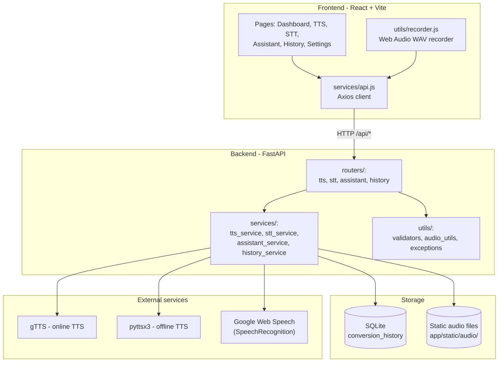
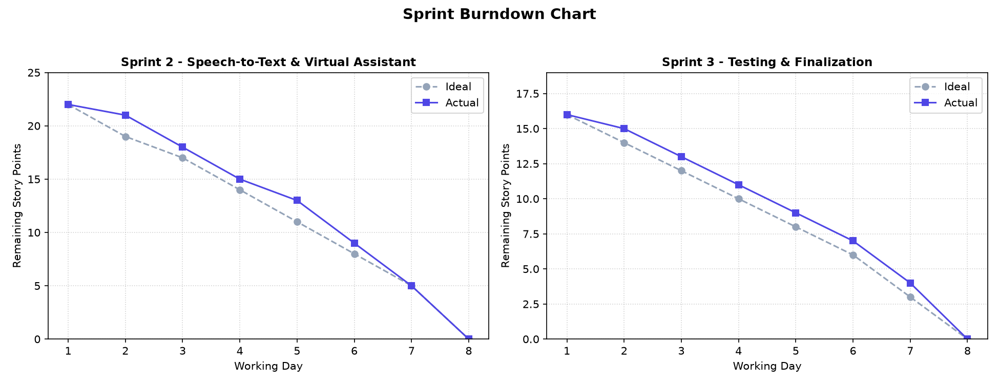

# Python Text-to-Speech, Speech-to-Text and Virtual Assistant

A full-stack academic project built with **Python (FastAPI)** and **React (Vite)** that converts text into
speech, converts speech into text, and runs a simple **rule-based virtual assistant** — plus history,
statistics, settings and a complete set of **Agile Software Development** artefacts.

> No AI, no machine learning, no LLM, no chatbot model. The assistant only executes predefined commands
> using Python conditions, dictionaries and handlers.

---

## Table of Contents

- [Project Overview](#project-overview)
- [Problem Statement](#problem-statement)
- [Objectives](#objectives)
- [Features](#features)
- [Technology Stack](#technology-stack)
- [Architecture](#architecture)
- [Folder Structure](#folder-structure)
- [Installation](#installation)
- [Backend Setup](#backend-setup)
- [Frontend Setup](#frontend-setup)
- [How to Run](#how-to-run)
- [API Endpoints](#api-endpoints)
- [Database](#database)
- [Text-to-Speech Module](#text-to-speech-module)
- [Speech-to-Text Module](#speech-to-text-module)
- [Virtual Assistant Module](#virtual-assistant-module)
- [User Stories](#user-stories)
- [Product Backlog](#product-backlog)
- [Sprint Planning](#sprint-planning)
- [Kanban Board](#kanban-board)
- [Agile Practices Used](#agile-practices-used)
- [Testing](#testing)
- [Continuous Integration](#continuous-integration)
- [Continuous Delivery](#continuous-delivery)
- [Version Control](#version-control)
- [Screenshots](#screenshots)
- [Future Scope](#future-scope)
- [Limitations](#limitations)
- [Conclusion](#conclusion)

---

## Project Overview

VoiceSuite is a web application where a user can type text and listen to it, speak into a microphone and
read the transcription, upload an audio file and transcribe it, and command a small rule-based assistant
that can tell the time and date, open websites, search Google and explain itself.

Every action is stored in SQLite and shown in a searchable history page, aggregated on a dashboard, and
managed from a settings page with light/dark mode.

The project exists to demonstrate two things at once:

1. **Python programming** — FastAPI routing, service layering, SQLAlchemy persistence, file handling,
   validation, exception mapping and a pytest test suite (38 tests).
2. **Agile Software Development** — 4 sprints, 15 user stories, a product backlog, Kanban board,
   burndown chart, Scrum roles and ceremonies, TDD, refactoring, risk-based testing, CI and CD,
   all documented in [`docs/agile/`](docs/agile/).

## Problem Statement

Many basic desktop and web tools only solve one problem: either they convert text to speech, or they
transcribe audio. Students and end users often need all three capabilities — text-to-speech,
speech-to-text and a small command-driven assistant — in one place, with a clean interface, persistent
history, and without depending on expensive AI services or cloud subscriptions.

The problem this project solves:

> Build a single Python application that converts **text to speech**, converts **speech to text**
> (from a microphone or an uploaded file), and provides a **simple rule-based virtual assistant**,
> with a modern web interface, persistent history, tests, and a full Agile development process.

## Objectives

1. Convert user-entered text into playable and downloadable audio.
2. Record microphone audio in the browser and convert it into text.
3. Upload an audio file (WAV/MP3/OGG/WebM/FLAC/M4A) and convert it into text.
4. Provide a **rule-based** virtual assistant that answers only predefined commands and speaks its reply.
5. Store every conversion in SQLite and expose search, filter, delete and clear-history operations.
6. Show dashboard statistics and recent activity.
7. Deliver a modern, responsive, light/dark interface.
8. Validate input and return friendly, user-readable error messages.
9. Ship automated tests (pytest) and a GitHub Actions CI pipeline.
10. Document the whole process with Agile artefacts suitable for a university submission.

## Features

| Area | Features |
|------|----------|
| **Dashboard** | Total TTS / STT / assistant counters, recent activity feed, 4 quick-action buttons, backend connection banner |
| **Text to Speech** | Large text area, 5000-character counter, language selection, engine selection (auto / gTTS / pyttsx3), speech-rate slider, convert button with loading state, audio player, replay, download, timestamp, history save |
| **Speech to Text** | Microphone recording with animated record button, recording timer and indicator, drag-and-drop or click file upload, file type + 10 MB size validation, recognised text box, copy to clipboard, download `.txt`, reset, friendly recognition errors |
| **Virtual Assistant** | Typed input and microphone input, chat bubbles with timestamps, rule-based responses (greeting, time, date, open Google, open YouTube, search Google, help, about, clear), clickable command chips, "Speak response" button, clear chat |
| **History** | Type filter (all/tts/stt/assistant), text search with debounce, per-row delete with confirmation modal, clear-all with confirmation, download a record as `.txt`, inline audio playback |
| **Settings** | Light/dark mode, default language, speech rate, auto-play toggle, backend status check — persisted in `localStorage` |
| **UI/UX** | Collapsing sidebar on mobile, toast notifications, empty states, loading spinners, hover effects, responsive grids, keyboard (Enter) submit |

## Technology Stack

### Backend

| Technology | Purpose |
|------------|---------|
| Python 3.13 | Main programming language |
| FastAPI | Web framework, routing, validation, OpenAPI docs at `/docs` |
| Uvicorn | ASGI server |
| SQLAlchemy 2 | ORM for the SQLite database |
| SQLite | Lightweight file database (no setup required) |
| Pydantic v2 | Request/response schemas and validation |
| gTTS | Online text-to-speech engine (MP3) |
| pyttsx3 | Offline text-to-speech engine (WAV) |
| SpeechRecognition | Speech-to-Text transcription |
| pydub | Conversion of MP3/OGG/WebM uploads (requires ffmpeg) |
| pytest + httpx | Automated test suite and FastAPI `TestClient` |

### Frontend

| Technology | Purpose |
|------------|---------|
| React 18 | UI library |
| Vite 6 | Build tool and dev server (with API proxy) |
| JavaScript (ES modules) | Application logic |
| Axios | HTTP client |
| lucide-react | Icon set |
| Web Audio API | In-browser WAV microphone recording |
| CSS (custom design system) | Light/dark themes, responsive layout, animations |

## Architecture



**Request flow:** React page → Axios (`/api/...`) → FastAPI router → service module → SQLite / static
file / speech engine → JSON response → React state → rendered UI.

## Folder Structure

```
project/
│
├── README.md
├── .gitignore
├── .github/
│   └── workflows/
│       └── ci.yml
│
├── backend/
│   ├── app/
│   │   ├── main.py                 # FastAPI app, CORS, static mount, error handlers
│   │   ├── database.py             # SQLite engine, session, Base
│   │   ├── models/
│   │   │   └── history.py          # ConversionHistory table
│   │   ├── schemas/
│   │   │   ├── tts.py  stt.py  assistant.py  history.py  common.py
│   │   ├── routers/
│   │   │   ├── tts.py  stt.py  assistant.py  history.py
│   │   ├── services/
│   │   │   ├── tts_service.py      # gTTS / pyttsx3 engines
│   │   │   ├── stt_service.py      # SpeechRecognition transcription
│   │   │   ├── assistant_service.py# rule-based command handlers
│   │   │   └── history_service.py  # CRUD + statistics
│   │   ├── utils/
│   │   │   ├── validators.py  audio_utils.py  exceptions.py
│   │   └── static/audio/           # generated audio files
│   ├── data/                       # SQLite database file (git-ignored)
│   ├── tests/                      # 7 pytest files, 38 tests
│   ├── pytest.ini
│   └── requirements.txt
│
├── frontend/
│   ├── src/
│   │   ├── components/             # Sidebar, Topbar, StatCard, AudioPlayer,
│   │   │                           # MicrophoneButton, LoadingSpinner, HistoryTable,
│   │   │                           # ConfirmationModal, Toast, EmptyState
│   │   ├── pages/                  # Dashboard, TextToSpeech, SpeechToText,
│   │   │                           # Assistant, History, Settings
│   │   ├── services/api.js
│   │   ├── context/SettingsContext.jsx
│   │   ├── utils/                  # recorder.js, format.js
│   │   ├── App.jsx
│   │   ├── main.jsx
│   │   └── index.css
│   ├── package.json
│   └── vite.config.js
│
└── docs/
    └── agile/                      # 22 Agile documents + burndown chart
```

## Installation

### Prerequisites

| Tool | Version used | Check |
|------|--------------|-------|
| Python | 3.11+ (developed on 3.13) | `python --version` |
| Node.js | 18+ (developed on 22) | `node --version` |
| npm | 9+ | `npm --version` |
| ffmpeg | optional — only for MP3/OGG/WebM **upload** conversion | `ffmpeg -version` |
| Git | 2.x | `git --version` |

> The microphone recorder produces WAV files in the browser, so **ffmpeg is not required** for the core
> workflow. Install it only if you want to upload compressed audio formats.

### 1. Clone the repository

```bash
git clone https://github.com/<your-username>/python-text-speech-assistant.git
cd python-text-speech-assistant
```

### 2. Create a virtual environment (recommended)

```bash
python -m venv .venv

# Windows
.venv\Scripts\activate
# macOS / Linux
source .venv/bin/activate
```

## Backend Setup

```bash
cd backend
pip install -r requirements.txt
```

Run the server:

```bash
uvicorn app.main:app --reload --port 8000
```

- API root: <http://127.0.0.1:8000/>
- Health check: <http://127.0.0.1:8000/health>
- Interactive API docs (Swagger UI): <http://127.0.0.1:8000/docs>

The SQLite database (`backend/data/conversions.db`) and the `static/audio/` folder are created
automatically on first start.

Run the backend tests:

```bash
cd backend
python -m pytest        # expected: 38 passed
```

## Frontend Setup

```bash
cd frontend
npm install
npm run dev
```

Open <http://localhost:5173>. The Vite dev server proxies `/api` and `/static` to
`http://127.0.0.1:8000`, so no extra configuration is needed.

Production build:

```bash
npm run build     # output in frontend/dist
npm run preview
```

## How to Run

Open **two terminals**:

```terminal 1 - Backend
cd backend
pip install -r requirements.txt
uvicorn app.main:app --reload --port 8000
```

```terminal 2 - Frontend
cd frontend
npm install
npm run dev
```

Then visit **<http://localhost:5173>**.

| Step | Action |
|------|--------|
| 1 | Open the **Text to Speech** page, type a sentence, press **Convert to speech**, then play/download the audio |
| 2 | Open **Speech to Text**, press the microphone, allow access, speak, press stop, then **Convert speech to text** |
| 3 | Or drop a WAV file on the upload tab and convert it |
| 4 | Open **Virtual Assistant**, type `what time is it` or press the microphone and say `open Google` |
| 5 | Check **History** for all records, search/filter/delete them |
| 6 | Toggle **Dark mode** on **Settings** |

## API Endpoints

| Method | Endpoint | Description | Success code |
|--------|----------|-------------|--------------|
| GET | `/` | API root and endpoint list | 200 |
| GET | `/health` | Health check (used by CI and the Settings page) | 200 |
| POST | `/api/tts` | Convert text to speech, returns `audio_url` | 201 |
| GET | `/api/tts/languages` | Languages supported by the TTS engines | 200 |
| POST | `/api/stt` | Multipart upload (`file`, `language`, `source`) → transcript | 201 |
| POST | `/api/assistant` | Execute a predefined command | 201 |
| GET | `/api/assistant/commands` | List of supported commands | 200 |
| GET | `/api/history` | List history (`type`, `search`, `limit`, `offset`) | 200 |
| DELETE | `/api/history/{id}` | Delete one record (404 if missing) | 200 |
| DELETE | `/api/history` | Clear all history (`type` query optional) | 200 |
| GET | `/api/stats` | Dashboard counters and recent activity | 200 |

**Example requests**

```bash
curl -X POST http://127.0.0.1:8000/api/tts \
  -H "Content-Type: application/json" \
  -d '{"text":"Hello, welcome to my project","language":"en","rate":175}'

curl -X POST http://127.0.0.1:8000/api/stt -F "file=@recording.wav" -F "language=en" -F "source=microphone"

curl -X POST http://127.0.0.1:8000/api/assistant \
  -H "Content-Type: application/json" \
  -d '{"text":"what is today\'s date","speak":true}'

curl "http://127.0.0.1:8000/api/history?type=tts&search=hello"
```

**Error responses** use a consistent JSON body `{"detail": "human readable message"}`:

| Status | Meaning | Example |
|--------|---------|---------|
| 422 | Validation / domain error | empty text, unsupported audio file, speech not recognised |
| 404 | Record not found | `DELETE /api/history/9999` |
| 413 | Upload too large | file > 10 MB |
| 502 | Upstream speech engine failure | gTTS unreachable and pyttsx3 unavailable |

## Database

Single table created automatically by SQLAlchemy on startup:

```sql
CREATE TABLE conversion_history (
    id          INTEGER PRIMARY KEY AUTOINCREMENT,
    type        VARCHAR(20)  NOT NULL,   -- 'tts' | 'stt' | 'assistant'
    input_text  TEXT         NOT NULL,
    output_text TEXT         NOT NULL,
    audio_path  VARCHAR(255),
    created_at  DATETIME     NOT NULL
);
```

| Column | Meaning |
|--------|---------|
| `type` | Which module created the record |
| `input_text` | What the user typed/spoke (or the file name for STT) |
| `output_text` | The transcript, assistant response, or audio engine note |
| `audio_path` | URL of the generated audio (`/static/audio/<id>.mp3`), when applicable |
| `created_at` | UTC timestamp used by the history table |

## Text-to-Speech Module

**Flow:** `TextToSpeech.jsx` → `POST /api/tts` → `tts_service.synthesize()` → `store_audio()` →
`conversion_history` row → JSON with `audio_url`.

**Engines** (selected in `backend/app/services/tts_service.py`):

| Engine | Type | Network | Output | Notes |
|--------|------|---------|--------|-------|
| `gtts` | Online | Required | MP3 | Fast, many languages |
| `pyttsx3` | Offline | Not required | WAV | Uses SAPI5 on Windows, espeak-ng on Linux |
| `auto` | Hybrid | — | MP3/WAV | Tries gTTS, falls back to pyttsx3 |

**Validation:** text is trimmed, cannot be empty, maximum 5000 characters; the language is checked
against the supported list; the rate is limited to 80–300 words per minute.

## Speech-to-Text Module

**Flow:** browser (WAV recorder or file picker) → `POST /api/stt` (multipart) →
`validate_upload()` → optional pydub conversion → `SpeechRecognition.recognize_google()` → transcript
saved to `conversion_history`.

| Aspect | Behaviour |
|--------|-----------|
| Microphone | `utils/recorder.js` uses `getUserMedia` + `ScriptProcessor` and encodes PCM WAV in the browser — no server-side ffmpeg needed |
| Upload formats | `.wav .mp3 .ogg .webm .flac .m4a .aac .aiff` |
| Upload limit | 10 MB (enforced in `audio_utils.validate_upload` and again while streaming) |
| Privacy of errors | Permission denied → "Microphone permission denied. Please allow microphone access..."; unclear audio → "Speech was not recognised..."; service unreachable → "The speech recognition service is unavailable..." |
| Output | Editable text box, copy button, `.txt` download, reset |

## Virtual Assistant Module

Rule-based only. `assistant_service.match_command()` normalises the input (lowercase, collapse spaces)
and checks it against an ordered set of rules:

| Command (examples) | `command_type` | Response |
|--------------------|----------------|----------|
| `hello`, `hi`, `hey` | `greeting` | Greeting + hint to ask for help |
| `what time is it` | `time` | Current time (`%I:%M %p`) |
| `what is today's date` | `date` | Today's date (`%A, %d %B %Y`) |
| `open Google` | `open_url` | Opens google.com via `webbrowser` |
| `open YouTube` | `open_url` | Opens youtube.com |
| `search Google for python` | `search` | Opens a Google search URL |
| `help` | `help` | Lists all supported commands |
| `about application` | `about` | Describes this project |
| `clear` | `clear` | Clears the conversation |
| anything else | `unknown` | Fixed fallback message |

Typed **and** microphone input are supported: mic audio is transcribed first, then executed as a command.
Responses can be spoken back with **Speak response**, which generates audio through the same TTS service.
Every interaction is timestamped and stored in history.

## User Stories

15 user stories with priority, story points and acceptance criteria are documented in
**[docs/agile/USER_STORIES.md](docs/agile/USER_STORIES.md)** (64 story points total).

| ID | Story | Points | Priority | Sprint |
|----|-------|--------|----------|--------|
| US-01 | Convert text to speech | 8 | High | Sprint 1 |
| US-02 | Choose language and speech rate | 5 | Medium | Sprint 1 |
| US-03 | Play, replay and download generated audio | 5 | Medium | Sprint 1 |
| US-04 | Speech-to-text from the microphone | 8 | High | Sprint 2 |
| US-05 | Speech-to-text from an uploaded audio file | 5 | High | Sprint 2 |
| US-06 | View, copy and download recognised text | 3 | Medium | Sprint 2 |
| US-07 | Send typed commands to the virtual assistant | 5 | High | Sprint 2 |
| US-08 | Speak commands to the virtual assistant | 3 | Medium | Sprint 2 |
| US-09 | Hear the assistant speak its response | 2 | Low | Sprint 2 |
| US-10 | View the conversion history | 5 | High | Sprint 2 |
| US-11 | Search and filter the history | 2 | Medium | Sprint 2 |
| US-12 | Delete a record or clear the history | 2 | Medium | Sprint 2 |
| US-13 | View dashboard statistics and recent activity | 3 | High | Sprint 2 |
| US-14 | Change theme and speech settings | 5 | Medium | Sprint 3 |
| US-15 | Receive friendly errors at any screen size | 3 | High | Sprint 3 |
| | **Total** | **64** | | |

> Acceptance criteria for each story live in
> [docs/agile/USER_STORIES.md](docs/agile/USER_STORIES.md).

## Product Backlog

The prioritised backlog with sprint assignment and status is in
**[docs/agile/PRODUCT_BACKLOG.md](docs/agile/PRODUCT_BACKLOG.md)**:

`| ID | User Story | Feature | Priority | Story Points | Sprint | Status |`

All 30 backlog items are marked **Done**; story points per sprint sum to 8 / 18 / 22 / 16.

## Sprint Planning

Four sprints are described in full (goal, tasks, points, deliverables, acceptance criteria, risks,
review and retrospective) in **[docs/agile/SPRINT_PLAN.md](docs/agile/SPRINT_PLAN.md)**.

| Sprint | Goal | Main Features | Story Points | Status |
|--------|------|---------------|--------------|--------|
| Sprint 0 | Setup | Planning and architecture | 8 | Completed |
| Sprint 1 | TTS | Text-to-Speech | 18 | Completed |
| Sprint 2 | STT & Assistant | Speech recognition and assistant | 22 | Completed |
| Sprint 3 | Quality | Testing, CI and UI improvements | 16 | Completed |

Supporting artefacts:

- Daily Scrum logs and ceremonies → [SCRUM_CEREMONIES.md](docs/agile/SCRUM_CEREMONIES.md)
- Roles → [SCRUM_ROLES.md](docs/agile/SCRUM_ROLES.md)
- Burndown chart + velocity → [BURNDOWN.md](docs/agile/BURNDOWN.md)
  ()

## Kanban Board

**[docs/agile/KANBAN_BOARD.md](docs/agile/KANBAN_BOARD.md)** tracks every task across
**Backlog → To Do → In Progress → Testing → Done**, with WIP limits (max 3 in progress, max 4 in
testing), movement rules, blocked-card handling and cycle-time notes.

## Agile Practices Used

| Practice | Artefact |
|----------|----------|
| Agile Manifesto values & 12 principles | [AGILE_MANIFESTO.md](docs/agile/AGILE_MANIFESTO.md) |
| Requirements engineering & traceability | [REQUIREMENTS_ENGINEERING.md](docs/agile/REQUIREMENTS_ENGINEERING.md) |
| User stories & product backlog | [USER_STORIES.md](docs/agile/USER_STORIES.md), [PRODUCT_BACKLOG.md](docs/agile/PRODUCT_BACKLOG.md) |
| Scrum roles, ceremonies, sprints | [SCRUM_ROLES.md](docs/agile/SCRUM_ROLES.md), [SCRUM_CEREMONIES.md](docs/agile/SCRUM_CEREMONIES.md), [SPRINT_PLAN.md](docs/agile/SPRINT_PLAN.md) |
| Kanban & WIP limits | [KANBAN_BOARD.md](docs/agile/KANBAN_BOARD.md) |
| Burndown & velocity | [BURNDOWN.md](docs/agile/BURNDOWN.md) |
| Feature-Driven Development | [FDD.md](docs/agile/FDD.md) |
| Lean Software Development | [LEAN.md](docs/agile/LEAN.md) |
| Extreme Programming | [XP.md](docs/agile/XP.md) |
| Refactoring | [REFACTORING.md](docs/agile/REFACTORING.md) |
| Test-Driven Development | [TDD.md](docs/agile/TDD.md) |
| Testing strategy & acceptance tests | [TESTING_STRATEGY.md](docs/agile/TESTING_STRATEGY.md), [ACCEPTANCE_TESTS.md](docs/agile/ACCEPTANCE_TESTS.md) |
| Risk-based testing | [RISK_BASED_TESTING.md](docs/agile/RISK_BASED_TESTING.md) |
| Continuous Integration / Delivery | [CONTINUOUS_INTEGRATION.md](docs/agile/CONTINUOUS_INTEGRATION.md), [CONTINUOUS_DELIVERY.md](docs/agile/CONTINUOUS_DELIVERY.md) |
| Version control workflow | [VERSION_CONTROL.md](docs/agile/VERSION_CONTROL.md) |
| Definition of Done & Quality Assurance | [DEFINITION_OF_DONE.md](docs/agile/DEFINITION_OF_DONE.md), [QUALITY_ASSURANCE.md](docs/agile/QUALITY_ASSURANCE.md) |

## Testing

### Backend — pytest (38 tests)

| Test file | Coverage |
|-----------|----------|
| `test_health.py` | `/health`, `/` root payload |
| `test_tts.py` | empty text rejected (TDD Red/Green), text over limit, successful conversion, audio file served, languages endpoint |
| `test_stt.py` | WAV transcription, unsupported file, empty file, recogniser failure message, history saved |
| `test_assistant.py` | greeting, time, date, open Google, search, help, unknown command, empty input, speak audio, commands list |
| `test_history.py` | list all types, filter by type, search, invalid filter, delete single, delete missing → 404, clear all, stats |
| `test_validation.py` | shared validators, invalid JSON body, unknown route, engine fallback, oversized payload |

```bash
cd backend
python -m pytest
# 38 passed in ~0.6s
```

Tests run **offline**: `tests/conftest.py` patches the TTS engines, the recogniser and the browser
opener, and uses an isolated in-memory SQLite database per test.

### Frontend

- `npm run build` validates that every module compiles (Vite/esbuild).
- Manual/acceptance checklist: 30 cases in
  [ACCEPTANCE_TESTS.md](docs/agile/ACCEPTANCE_TESTS.md) (all **Pass**).

### Agile testing documentation

- [TESTING_STRATEGY.md](docs/agile/TESTING_STRATEGY.md) — unit, integration, acceptance, regression,
  risk-based and automated testing
- [TDD.md](docs/agile/TDD.md) — three worked Red/Green/Refactor cycles
- [RISK_BASED_TESTING.md](docs/agile/RISK_BASED_TESTING.md) — risk register and prioritised testing
- [QUALITY_ASSURANCE.md](docs/agile/QUALITY_ASSURANCE.md) — metrics and manual checklist

## Continuous Integration

`.github/workflows/ci.yml` runs on every push and pull request to `main` / `develop`:

```
checkout → setup Python 3.13 → pip install -r requirements.txt → python -m pytest
        → setup Node 20 → npm ci → npm run build
```

Two parallel jobs: **backend-tests** (pytest) and **frontend-build** (vite). A red build blocks the
merge — see [CONTINUOUS_INTEGRATION.md](docs/agile/CONTINUOUS_INTEGRATION.md).

## Continuous Delivery

Every green CI run leaves a **releasable increment**: a passing test suite and a built `frontend/dist`
bundle. The project uses **Continuous Delivery** (a ready-to-release build is always produced);
automatic deployment to a server is **not** configured and is listed under
[Future Scope](#future-scope). Details in
[CONTINUOUS_DELIVERY.md](docs/agile/CONTINUOUS_DELIVERY.md).

## Version Control

Git flow with feature branches:

```
main ─────────────●────────────●────  (protected, CI required)
                  ▲
develop ────●─────┴────●───────┴────
             ▲        ▲
feature/text-to-speech─┘
feature/speech-to-text────┘
feature/virtual-assistant─┘
feature/history────────────┘
feature/dashboard-ui───────┘
feature/testing-ci─────────┘
```

Conventional commit messages used in the repository:

```
feat: add text to speech conversion
feat: add speech recognition
feat: add virtual assistant commands
fix: validate unsupported audio files
test: add history API test
docs: add sprint plan
refactor: move speech logic to service
```

Full branching model, PR checklist and `.gitignore` policy:
[VERSION_CONTROL.md](docs/agile/VERSION_CONTROL.md).

## Screenshots

> Replace the placeholders below with your own captures after running the project.

| Page | Screenshot |
|------|------------|
| Dashboard | `docs/screenshots/dashboard.png` |
| Text to Speech (with audio result) | `docs/screenshots/text-to-speech.png` |
| Speech to Text (recording state) | `docs/screenshots/speech-to-text.png` |
| Virtual Assistant conversation | `docs/screenshots/assistant.png` |
| History with filter and modal | `docs/screenshots/history.png` |
| Settings (dark mode) | `docs/screenshots/settings-dark.png` |
| Swagger UI at `/docs` | `docs/screenshots/api-docs.png` |
| Sprint burndown chart | `docs/agile/burndown_chart.png` |

**How to capture them:** start the backend and frontend, open <http://localhost:5173>, press
`Win + Shift + S` (Windows) or use the browser dev-tools device toolbar for the mobile view.

## Future Scope

- Audio waveform visualisation for recordings
- Export history to CSV / PDF
- Offline-first mode with a service worker (PWA)
- Additional languages and voices (e.g. edge-tts engine)
- Docker Compose one-command setup
- Deploy the API (e.g. Render/Railway) and serve `frontend/dist` from FastAPI
- Word-level timestamps for transcripts
- Keyboard shortcuts and accessibility audit (WCAG)

## Limitations

- **Speech-to-Text needs the internet** — `SpeechRecognition` uses the free Google Web Speech endpoint;
  without a network the transcript request fails with a friendly error.
- **gTTS needs the internet** — the offline `pyttsx3` engine is used as a fallback, but its voice
  quality depends on the operating system (SAPI5 / espeak-ng).
- **Compressed upload formats need ffmpeg** — MP3/OGG/WebM uploads are converted with pydub; without
  ffmpeg only WAV/FLAC/AIFF uploads work. Browser recording always works because it produces WAV.
- **Recognition accuracy** depends on microphone quality, background noise and the language selected.
- **The assistant is intentionally limited** to its predefined commands; it has no natural-language
  understanding — this is a requirement of the project scope, not a defect.
- **Single-user local application** — there is no authentication, and the history table is shared.

## Conclusion

VoiceSuite delivers the three required capabilities — **Text-to-Speech**, **Speech-to-Text** and a
**rule-based Virtual Assistant** — in a modern, responsive web interface backed by a modular FastAPI
service and a SQLite database.

The codebase is organised in routers, services, schemas and utilities so each module can be developed
and tested independently, and the 38-test pytest suite plus the GitHub Actions pipeline keep the
increment releasable after every change.

Equally important, the `docs/agile/` folder shows the full Agile process behind the code: 15 user
stories, a prioritised backlog, four sprints with reviews and retrospectives, a Kanban board with WIP
limits, a burndown chart, TDD and refactoring logs, risk-based testing, and CI/CD documentation —
making the project a complete demonstration of both Python programming and Agile Software Development.

---

### Academic Notes

- **Course:** Software Engineering / Agile Development (university project)
- **Team:** Individual project — all three Scrum roles simulated by the student
  (see [SCRUM_ROLES.md](docs/agile/SCRUM_ROLES.md))
- **Scope compliance:** no AI, ML, LLM, chatbot, recommendation, sentiment or authentication features
  were added beyond what the brief requires.
