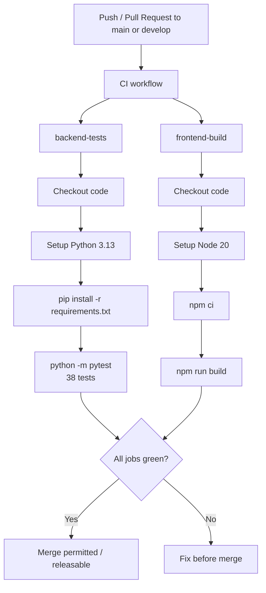

# Continuous Integration (CI)

## 1. What is CI

Continuous Integration is a software development practice in which every developer integrates (merges) their work into a shared mainline frequently — ideally several times a day — and every such integration is verified automatically by building the system and running its tests. The term originates from Extreme Programming (Kent Beck) and is described formally by Martin Fowler as *"a software development practice where members of a team integrate their work frequently, usually each person integrates at least daily — leading to multiple integrations per day."*

Two halves make the definition work:

1. **Frequent merging** into a shared branch, so that integration is routine rather than a dramatic event at the end.
2. **Automated verification** of every integration, so that a broken build is discovered in minutes, by a machine, not days later by a person.

A commit that is not automatically verified is not continuous integration — it is only frequent merging.

---

## 2. Why it is used

| Problem without CI | What CI provides |
|--------------------|------------------|
| "Integration day" — merging weeks of divergent work, discovering conflicts then | Small, frequent merges that conflict in minutes, not months |
| A change that broke something three stories ago is found late | Immediate feedback: the build and test result for every push |
| "It works on my machine" | A neutral environment (ubuntu-latest, pinned Python 3.13, Node 20) verifies the claim |
| Tests run only when someone remembers | Tests executed on **every** push and pull request, by default |
| Fear of merging | A green mainline that is always releasable |
| Nobody knows whether the code compiles | Build validation is a visible status check on the branch |

**For this project specifically**, CI replaced the riskiest habit of coursework development: long periods of uncommitted or unmerged work. With two jobs (backend tests, frontend build) running on each push, a broken change was visible on the GitHub repository within minutes, and `main` could only ever contain code for which both the 38-test suite and the Vite build had passed.

---

## 3. The CI Pipeline for this Project

The pipeline defined in `.github/workflows/ci.yml` executes these steps:

| Step | Name | What it does | Why |
|-----:|------|--------------|-----|
| 1 | **Checkout code** | `actions/checkout@v4` places the repository contents on the runner | Every subsequent step needs the source |
| 2 | **Set up Python** | `actions/setup-python@v5` with `python-version: "3.13"` and `cache: pip` | Guarantees the exact interpreter version the project targets; pip cache shortens later runs |
| 3 | **Install backend dependencies** | `pip install -r requirements.txt` (run in `backend/`) | Installs FastAPI, Uvicorn, SQLAlchemy, Pydantic, gTTS, pyttsx3, SpeechRecognition, pydub, pytest |
| 4 | **Run backend tests** | `python -m pytest` (run in `backend/`) | Executes all 38 tests; any failure fails the `backend-tests` job |
| 5 | **Set up Node.js** | `actions/setup-node@v4` with `node-version: "20"`, `cache: npm`, `cache-dependency-path: frontend/package-lock.json` | Reproducible Node toolchain; cached dependency download |
| 6 | **Install frontend dependencies** | `npm ci` (run in `frontend/`) | Clean, lockfile-exact install — `npm ci` never silently resolves a different version than `npm install` |
| 7 | **Build frontend** | `npm run build` (run in `frontend/`) | Vite compiles the React 18 application; any syntax, import or type-level error fails the `frontend-build` job |

The two jobs run **in parallel** — the frontend does not wait for the backend — so total pipeline time is roughly the slower of the two.

### 3.1 Pipeline diagram

```text
                     push / pull_request
                     on [main, develop]
                              │
              ┌───────────────┴───────────────┐
              │            CI workflow         │
              └───────────────┬───────────────┘
                              │
            ┌─────────────────┴─────────────────┐
            │                                    │
            ▼                                    ▼
 ┌──────────────────────────┐      ┌──────────────────────────┐
 │  job: backend-tests      │      │  job: frontend-build     │
 │  runs-on: ubuntu-latest  │      │  runs-on: ubuntu-latest  │
 │  cwd: backend            │      │  cwd: frontend           │
 ├──────────────────────────┤      ├──────────────────────────┤
 │ 1. checkout@v4           │      │ 1. checkout@v4           │
 │ 2. setup-python@v5       │      │ 5. setup-node@v4         │
 │    python 3.13 + pip     │      │    node 20 + npm cache   │
 │ 3. pip install -r        │      │ 6. npm ci                │
 │    requirements.txt      │      │ 7. npm run build         │
 │ 4. python -m pytest      │      │    (Vite → dist/)        │
 └────────────┬─────────────┘      └────────────┬─────────────┘
              │                                  │
              └─────────────────┬────────────────┘
                                ▼
                   ┌────────────────────────┐
                   │  All jobs green        │
                   │  → check passes        │
                   │  → branch may merge    │
                   │  → releasable state    │
                   └────────────────────────┘
```



---

## 4. The Workflow File

The complete content of `.github/workflows/ci.yml`:

```yaml
name: CI

on:
  push:
    branches: [main, develop]
  pull_request:
    branches: [main, develop]

jobs:
  backend-tests:
    name: Backend tests (pytest)
    runs-on: ubuntu-latest
    defaults:
      run:
        working-directory: backend
    steps:
      - name: Checkout code
        uses: actions/checkout@v4
      - name: Set up Python
        uses: actions/setup-python@v5
        with:
          python-version: "3.13"
          cache: pip
      - name: Install backend dependencies
        run: pip install -r requirements.txt
      - name: Run backend tests
        run: python -m pytest

  frontend-build:
    name: Frontend build (vite)
    runs-on: ubuntu-latest
    defaults:
      run:
        working-directory: frontend
    steps:
      - name: Checkout code
        uses: actions/checkout@v4
      - name: Set up Node.js
        uses: actions/setup-node@v4
        with:
          node-version: "20"
          cache: npm
          cache-dependency-path: frontend/package-lock.json
      - name: Install frontend dependencies
        run: npm ci
      - name: Build frontend
        run: npm run build
```

Key points about the configuration:

- **Trigger scope.** The workflow runs only on `push` and `pull_request` events targeting `main` or `develop` — the two branches that receive merged work — so feature branches are validated when they are proposed for merge.
- **Working directories.** `defaults.run.working-directory` scopes each job to `backend/` or `frontend/`, so commands run where the manifests live without `cd` steps.
- **Pinned versions.** Python `3.13` and Node `20` match the documented local toolchain, eliminating "works on my machine" disagreements.
- **Dependency caching.** `cache: pip` and `cache: npm` with `cache-dependency-path: frontend/package-lock.json` reuse downloaded packages across runs, shortening feedback time.
- **`npm ci`, not `npm install`.** Installs exactly what `package-lock.json` specifies and fails if the lockfile and `package.json` disagree — a dependency-integrity check for free.
- **Two independent jobs.** A backend failure does not hide a frontend failure; both are reported on every run.

---

## 5. Automatic Testing

Without CI, tests are executed only when a developer chooses to run them — which, under deadline pressure, means not at all. CI removes the choice:

- `python -m pytest` runs automatically on **every** push and pull request to `main`/`develop`.
- The suite is hermetic by design: `backend/tests/conftest.py` patches the TTS engines and the recogniser, uses in-memory SQLite, and generates audio bytes with the `build_wav` fixture. No network, microphone or audio device exists on the runner, and none is needed.
- The full 38-test suite — health, TTS validation, STT uploads, assistant commands, history CRUD, statistics — must report **38 passed**. A single failure fails the job.
- Because the same command runs locally (`python -m pytest`) and in CI, a green local run is a reliable prediction of a green pipeline.

The effect in this project was that regression detection became involuntary: the 415-mapping regression described in `TESTING_STRATEGY.md` was caught by the suite before the branch was merged, not by a user after submission.

---

## 6. Build Validation

A passing test suite does not prove the application still builds. The `frontend-build` job validates that separately:

- `npm ci` validates that `package.json` and `package-lock.json` are consistent and installs an exact, reproducible dependency tree.
- `npm run build` runs the Vite production build over the React 18 application — `src/pages/*.jsx`, `src/components/*`, `services/api.js`, `context/SettingsContext.jsx`, `utils/recorder.js`. Any syntax error, unresolved import, missing export or invalid JSX fails the build with a non-zero exit code.
- The build artefact is `frontend/dist/`, which is exactly the artefact used for delivery (see `CONTINUOUS_DELIVERY.md`).

Build validation matters because a JavaScript application can contain errors that tests never touch — a typo'd import in `History.jsx` would only surface when a user opened that page. Making the build a gate means such errors are caught at merge time.

---

## 7. Early Error Detection

The economic argument for CI is the cost curve of defect discovery:

| When the defect is introduced | Typical discovery point without CI | Discovery point with CI |
|------------------------------|------------------------------------|-------------------------|
| Typo / broken import | User opens the page days later | `npm run build` in the same push |
| Failing validation rule | Manual retest, forgotten | `python -m pytest` in the same push |
| Regression in history deletion | End-of-sprint testing | Same push, minutes after the change |
| Dependency version conflict | On the reviewer's machine | `npm ci` on the runner |
| "Works locally" environment difference | Submission day | First CI run on ubuntu-latest |

By compressing the feedback loop from days to minutes, CI keeps the amount of unverified work small. In practice the repository never carried more than one or two unverified commits, because each push produced a verdict.

---

## 8. Benefits Realised in this Project

| Benefit | Evidence |
|---------|----------|
| Every change is verified automatically | Two jobs on each push/PR to `main` and `develop` |
| Regressions found in minutes, not days | The 415-mapping regression in `test_stt.py` caught before merge |
| Consistent environment | ubuntu-latest, Python 3.13, Node 20 — independent of the developer's Windows machine |
| Reproducible dependencies | `pip install -r requirements.txt` and `npm ci` from a lockfile |
| Mainline is always releasable | `main` only receives merges from a green `develop` |
| Evidence of quality for assessment | Visible green check runs on the repository, referenced in sprint reviews |
| Faster local iteration | Knowing CI runs the same commands encourages running them first — feedback before push |
| Parallel verification | Backend tests and frontend build run concurrently, keeping wall-clock time low |

---

## 9. Branch Strategy Used with CI

| Branch | Trigger | Checks |
|--------|---------|--------|
| `main` | `push` and `pull_request` targeting `main` | `backend-tests` (pytest, 38 tests) + `frontend-build` (`npm ci`, `npm run build`) |
| `develop` | `push` and `pull_request` targeting `develop` | Same two jobs — `develop` is the integration branch and is held to the same standard |
| `feature/text-to-speech` | Not triggered directly; validated when the PR targets `develop` or `main` | Same two jobs run on the pull request |
| `feature/speech-to-text` | Same | Same |
| `feature/virtual-assistant` | Same | Same |
| `feature/history` | Same | Same |
| `feature/dashboard-ui` | Same | Same |
| `feature/testing-ci` | Same | Same |

**Flow:** feature branch → open PR into `develop` → CI runs both jobs → reviewer merges only when green → at the end of a sprint `develop` is merged into `main`, which triggers CI again as a final confirmation.

---

## 10. Local Equivalent Commands

Running the same gates locally before pushing avoids burning CI cycles on trivial failures.

**Backend**

```bash
cd backend
pip install -r requirements.txt
python -m pytest
```

Expected output:

```text
============================= 38 passed in X.XXs ==============================
```

**Frontend**

```bash
cd frontend
npm ci
npm run build
```

Expected result: Vite writes `frontend/dist/` and exits with code 0.

**Combined pre-push check**

```bash
python -m pytest && npm run build
```

If both succeed locally, CI will almost certainly pass; if CI still fails, the difference is environmental (OS, Python minor version, locale) and is itself worth investigating.

---

## 11. Summary

Continuous Integration in this project is a single GitHub Actions workflow with two parallel jobs that verify every push and pull request to `main` and `develop`: install dependencies and run all 38 pytest tests on Python 3.13, and install dependencies and build the React application on Node 20. The practice converts testing from an occasional manual activity into an automatic property of the repository, which is what makes frequent merging safe and the mainline releasable.
