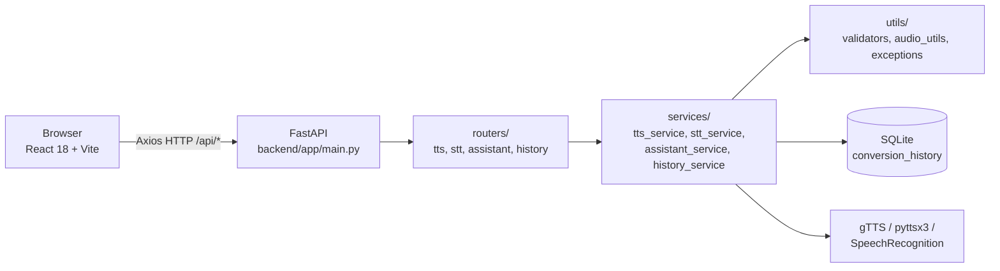

# Feature Driven Development (FDD)

## 1. Introduction

Feature Driven Development (FDD) is an iterative and incremental software development process originally described by Peter Coad, Eric Lefebvre and Jeff De Luca in *Java Modeling in Color with UML* (1999). FDD is model-driven and architecture-centric: it begins by building an overall object model of the system, then decomposes the model into a list of small, client-valued features that can be planned, designed and built in short iterations.

FDD defines five processes, two of which are a one-off activity performed at the start of the project (processes 1 and 2), and three of which are repeated for every iteration (processes 3, 4 and 5):

| # | Process | Type | Frequency |
|---|---------|------|-----------|
| 1 | Develop Overall Model | Model-driven, one-off | Once per project |
| 2 | Build Feature List | One-off, then maintained | Once per project, refined as needed |
| 3 | Plan by Feature | Iterative | Start of every iteration |
| 4 | Design by Feature | Iterative | Every feature (1–2 weeks) |
| 5 | Build by Feature | Iterative | Every feature (1–2 weeks) |

A "feature" in FDD is expressed in the grammatical form **verb + object** (for example *convert text to speech*), is small — typically implementable by one person in no more than two weeks — and delivers visible value to the client or user of the system.

---

## 2. The Five FDD Processes

### 2.1 Develop Overall Model

The chief architect and the development team work through the domain concept model produced during the initial project inception. Each subject-area (or "problem domain") is walked through in detail, object models are produced, and the results are consolidated into a single overall class diagram for the system.

**In this project**

The overall model for *Python Text-to-Speech, Speech-to-Text and Virtual Assistant* was documented as a layered architecture diagram with a Mermaid flow chart in `docs/agile/` and in the project README:



The model was decomposed into five subject areas:

| Subject Area | Classes / Modules | Responsibility |
|--------------|-------------------|----------------|
| Speech synthesis | `tts_service.py`, `TTSRequest` schema | Convert text to audio bytes |
| Speech recognition | `stt_service.py`, `audio_utils.py` | Convert audio bytes to text |
| Conversational control | `assistant_service.py`, command dicts | Map utterance → action |
| Persistence | `models/history.py`, `history_service.py` | Store/retrieve conversions |
| Presentation | `pages/*.jsx`, `components/*.jsx` | Render the six application pages |

### 2.2 Build Feature List

The overall model is decomposed into a list of features. Each feature is a small client-valued function expressed as verb-object, grouped by subject area, and assigned a unique feature ID so it can be tracked through planning, design, build and testing.

**In this project**

This produced the table in Section 3 of this document — 15 features mapped to the 15 user stories (US-01 … US-15) that were estimated at a total of 64 story points across four sprints. Grouping by subject area made the two large subject areas (speech synthesis and speech recognition) visible early, which is why Sprint 1 was allocated 18 points and Sprint 2 22 points.

### 2.3 Plan by Feature

An order of features is agreed with the client (the project supervisor) and sequenced by risk, dependency and priority. The project manager produces an initial development plan that lists features in build order, and revisits it at the start of every iteration based on measured velocity.

**In this project**

Features were ordered strictly by sprint, and within a sprint by dependency:

| Sprint | Features in build order |
|--------|-------------------------|
| Sprint 0 — Setup (8 pts) | F-01 validate user input (scaffolding), health endpoint, DB setup |
| Sprint 1 — TTS (18 pts) | F-02 convert text to speech → F-03 generate downloadable audio → F-12 persist history |
| Sprint 2 — STT & Assistant (22 pts) | F-04 record microphone audio → F-05 transcribe uploaded audio → F-06 execute assistant command → F-07 speak assistant response → F-08 search/filter history → F-09 delete history record |
| Sprint 3 — Testing/Finalization (16 pts) | F-10 display dashboard statistics → F-11 switch light/dark theme → CI, refactor, documentation |

Ordering put *convert text to speech* first because it exercised every layer of the architecture (validation → service → router → database → frontend) and therefore de-risked the remaining features.

### 2.4 Design by Feature

A small team (chief architect, object model lead, feature owner) takes one feature, walks through the relevant model, produces a sequence diagram for the feature, and identifies the classes and methods needed. The output is a class and method design that is reviewed and approved before coding starts.

**In this project**

Each feature produced a short design note covering the entry point, the service method, the schema and the database touch. For example, *convert text to speech* was designed as:

```text
POST /api/tts
  → routers/tts.py::synthesize(request: TTSRequest)
      → utils/validators.py::validate_text(text, field="text")
      → services/tts_service.py::synthesize(text, lang) -> bytes
      → services/history_service.py::add_record(type="tts", input_text, output_text, audio_path)
      → utils/audio_utils.py::save_audio(bytes, filename) -> audio_path
      → response: TTSResponse(audio_url, languages, engine)
```

and *execute assistant command* was designed around a lookup structure rather than a long conditional chain:

```python
# backend/app/services/assistant_service.py
COMMANDS = {
    "hello": handle_greeting,
    "what time is it": handle_time,
    "what is today's date": handle_date,
    "open google": handle_open_google,
    "open youtube": handle_open_youtube,
    "help": handle_help,
    "about application": handle_about,
    "clear": handle_clear,
}
```

Design-by-feature review is where the decision to keep the assistant strictly rule-based (Python conditions, dicts and handlers) was confirmed and recorded.

### 2.5 Build by Feature

The feature owner and a small team build the classes and methods designed in the previous process, unit-test them, integrate them into the main build, and mark the feature complete only when it compiles, passes its tests and is checked in.

**In this project**

Each feature was built as a **vertical slice**: schema → service → router → pytest test → React page/component → manual check in the browser. Example slice for *transcribe uploaded audio*:

1. `backend/app/schemas/` — STT response schema
2. `backend/app/services/stt_service.py` — recogniser call
3. `backend/app/utils/audio_utils.py` — `validate_upload()`, `convert_to_wav()`
4. `backend/app/routers/stt.py` — `POST /api/stt`
5. `backend/tests/` — upload, size-limit and unsupported-format tests
6. `frontend/src/pages/SpeechToText.jsx` + `components/MicrophoneButton.jsx`
7. Run `python -m pytest` and `npm run build`, then commit to `feature/speech-to-text`

---

## 3. Feature List for this Project

| Feature ID | Feature (verb-object) | User Story | Sprint | Owner | Status |
|------------|----------------------|------------|--------|-------|--------|
| F-01 | Validate user input | US-01 As a user I want invalid input rejected with a clear message so that I do not submit broken requests | Sprint 0 | Backend | Done |
| F-02 | Convert text to speech | US-02 As a user I want to convert typed text to audible speech so that I can listen to it | Sprint 1 | Backend | Done |
| F-03 | Generate downloadable audio | US-03 As a user I want to download and play the generated audio so that I can keep it | Sprint 1 | Frontend | Done |
| F-04 | Record microphone audio | US-04 As a user I want to record from my microphone in the browser so that I do not need a separate tool | Sprint 2 | Frontend | Done |
| F-05 | Transcribe uploaded audio | US-05 As a user I want to upload an audio file and get its text transcript | Sprint 2 | Backend | Done |
| F-06 | Execute assistant command | US-06 As a user I want to type a command and have the assistant perform the matching action | Sprint 2 | Backend | Done |
| F-07 | Speak assistant response | US-07 As a user I want to hear the assistant's reply read aloud | Sprint 2 | Backend | Done |
| F-08 | Search and filter history | US-09 As a user I want to search and filter past conversions so that I can find them quickly | Sprint 2 | Full-stack | Done |
| F-09 | Delete history record | US-10 As a user I want to delete a single record or clear all history | Sprint 2 | Full-stack | Done |
| F-10 | Display dashboard statistics | US-11 As a user I want counts of TTS/STT/assistant usage on a dashboard | Sprint 3 | Full-stack | Done |
| F-11 | Switch light/dark theme | US-12 As a user I want to switch between light and dark themes | Sprint 3 | Frontend | Done |
| F-12 | Store conversion history | US-08 As a user I want every conversion saved so that I can review it later | Sprint 1 | Backend | Done |
| F-13 | View speech-to-text page | US-13 As a user I want a dedicated STT page with mic and upload options | Sprint 2 | Frontend | Done |
| F-14 | View assistant page | US-14 As a user I want a chat-style page listing available commands | Sprint 2 | Frontend | Done |
| F-15 | Adjust application settings | US-15 As a user I want to change voice rate, voice and theme preferences | Sprint 3 | Frontend | Done |

**Notes on the list**

- Every feature is verb-object, small enough to be built inside a single two-week sprint, and demonstrable in the sprint review.
- Feature IDs are stable and are referenced from the sprint backlog, the acceptance test file (`docs/agile/ACCEPTANCE_TESTS.md`) and the pull request checklist.
- F-01 (*validate user input*) is deliberately early because validation is cross-cutting: `app/utils/validators.py` is used by the TTS, STT and assistant routers alike.

---

## 4. Class Ownership

FDD assigns explicit, stable ownership of each class to a named developer. Ownership is not exclusivity — anyone may read any class — but the owner is accountable for the design integrity of that class, approves changes to it, and is the first point of contact when something goes wrong.

| Class / Module | Owner role | In this project |
|----------------|-----------|-----------------|
| `app/services/tts_service.py` | Speech synthesis lead | Owns engine fallback chain, gTTS/pyttsx3 selection |
| `app/services/stt_service.py` | Speech recognition lead | Owns recogniser configuration and error mapping |
| `app/services/assistant_service.py` | Conversational lead | Owns `COMMANDS` dict and handler functions |
| `app/services/history_service.py` | Data lead | Owns CRUD and `GET /api/stats` aggregation |
| `app/utils/validators.py` | Architecture lead | Owns all shared input rules — changes require review |
| `frontend/src/components/*` | UI lead | Owns reusable `Sidebar`, `StatCard`, `AudioPlayer`, `MicrophoneButton`, `HistoryTable`, `ConfirmationModal`, `Toast`, `LoadingSpinner`, `EmptyState` |
| `frontend/src/pages/*` | UI lead | Composes components into the six pages |
| `backend/tests/*` | Quality lead | Owns fixtures in `conftest.py` and the 38-test suite |

**How this was applied in an individual academic project.** Formal ownership was simulated by recording, in the sprint backlog, which module each user story would modify and treating that module as "owned" for the duration of the story. Changes outside the owned module were flagged in the pull request description. When a class genuinely needed to be touched by two stories in the same sprint — for example `history_service.py` was needed by both *store conversion history* (F-12) and *display dashboard statistics* (F-10) — the stories were sequenced so only one touched it at a time.

In a team setting, class ownership is recorded in a simple table in the repository and reviewed at every iteration planning meeting; ownership may be handed over explicitly at the end of a sprint.

---

## 5. Just-In-Time (JIT) Design

FDD deliberately avoids up-front design of every class. Detailed design happens **just in time** — only for the feature that is about to be built, and only to the depth needed for that feature. Design work beyond the current feature is left until it becomes necessary, which keeps documentation honest and prevents the model from drifting away from the code.

**In this project**

- The overall model (Section 2.1) was held at module level — routers, services, utils, schemas — and was **not** expanded to method-level detail until Design by Feature for the specific story.
- `app/utils/validators.py` did not exist in the initial architecture sketch; it appeared only when the third story needed the same rule and the duplication became visible. Extracting it at that moment, rather than speculatively in Sprint 0, is a JIT design decision.
- The engine abstraction inside `tts_service.py` was designed just in time for F-02, and was deliberately left abstract so the choice between gTTS and pyttsx3 could be deferred until real usage (offline vs online) was observed.
- `history_service.py` was designed for F-12 as a plain CRUD module; the statistics aggregation for F-10 was added later as a second method on the same class rather than a separate `StatsService`, because by then the query shape was known.
- React components were extracted JIT: `HistoryTable` was created when *search and filter history* (F-08) revealed that the same table markup was needed on both the History page and the Dashboard, not before.

The practical rule applied was: **design the next feature, refactor what the last feature exposed, and leave everything else at module level.**

---

## 6. Summary

| FDD element | Realisation in this project |
|-------------|----------------------------|
| Develop Overall Model | Mermaid layered architecture: React → FastAPI → services → SQLite |
| Build Feature List | 15 verb-object features (F-01 … F-15) in Section 3 |
| Plan by Feature | Sprint 0 → 3 ordering, 64 points total |
| Design by Feature | Per-feature sequence sketches for `tts_service.synthesize()` and `assistant_service.COMMANDS` |
| Build by Feature | Vertical slices committed on `feature/*` branches with pytest coverage |
| Class Ownership | Module ownership table with named owner roles |
| JIT Design | `validators.py`, `history_service.py` stats method, React components extracted when duplication appeared |
